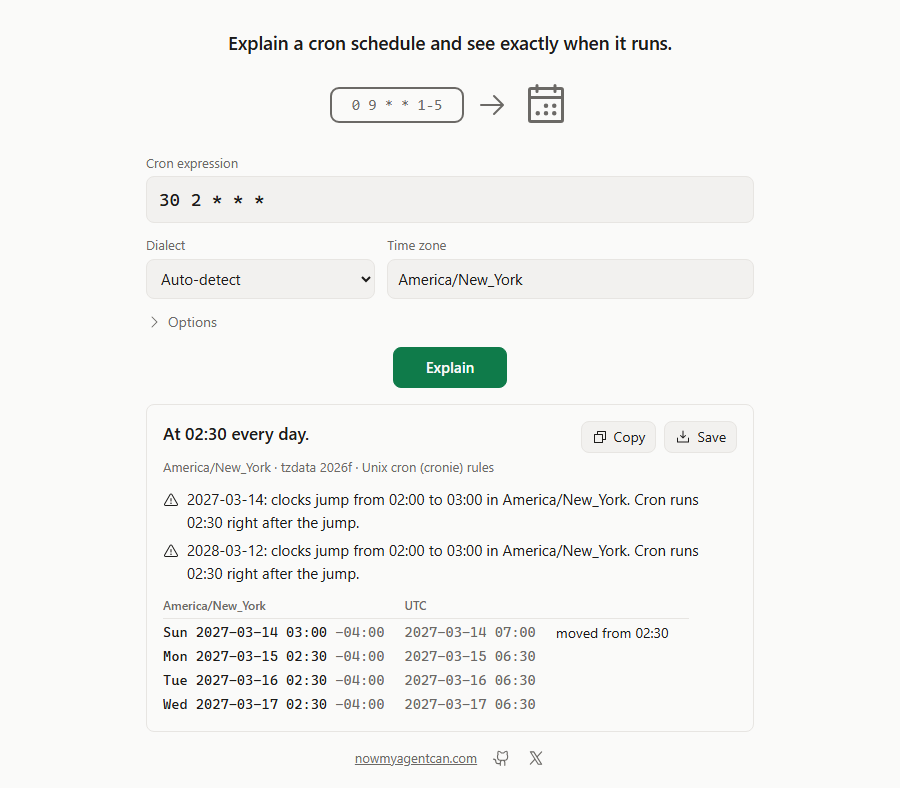

# time-cron

Explain a cron schedule and see exactly when it runs: Unix cron, Quartz and AWS EventBridge, in any time zone, with each scheduler's own daylight-saving rules.



## Install

Windows (PowerShell, no admin; installs to `%LOCALAPPDATA%\Programs\time-cron` and adds it to your user PATH):

```powershell
irm https://github.com/nowmyagentcan/time-cron/releases/latest/download/install.ps1 | iex
```

macOS and Linux (installs to `~/.local/bin`):

```sh
curl -fsSL https://github.com/nowmyagentcan/time-cron/releases/latest/download/install.sh | sh
```

Both scripts check the archive's SHA-256 against `SHA256SUMS` before installing anything. Or download an archive yourself; each holds one `time-cron` binary that needs no runtime:

| System | Download |
|---|---|
| Windows x64 | [time-cron-v0.1.0-windows-x64.zip](https://github.com/nowmyagentcan/time-cron/releases/download/v0.1.0/time-cron-v0.1.0-windows-x64.zip) |
| macOS Apple silicon | [time-cron-v0.1.0-macos-arm64.tar.gz](https://github.com/nowmyagentcan/time-cron/releases/download/v0.1.0/time-cron-v0.1.0-macos-arm64.tar.gz) |
| macOS Intel | [time-cron-v0.1.0-macos-x64.tar.gz](https://github.com/nowmyagentcan/time-cron/releases/download/v0.1.0/time-cron-v0.1.0-macos-x64.tar.gz) |
| Linux x64 (static) | [time-cron-v0.1.0-linux-x64.tar.gz](https://github.com/nowmyagentcan/time-cron/releases/download/v0.1.0/time-cron-v0.1.0-linux-x64.tar.gz) |
| Linux arm64 (static) | [time-cron-v0.1.0-linux-arm64.tar.gz](https://github.com/nowmyagentcan/time-cron/releases/download/v0.1.0/time-cron-v0.1.0-linux-arm64.tar.gz) |

With Rust: `cargo install --git https://github.com/nowmyagentcan/time-cron --tag v0.1.0 --locked`.
To remove it, delete the binary (on Windows, the `time-cron` folder above).

## Use

```sh
time-cron "*/15 9-17 * * 1-5"                       # next 5 runs in this computer's time zone
time-cron explain "0 0 12 ? * MON#2"                # what each field means, likely mistakes
time-cron convert "0 9 * * 1-5" --to aws            # cron(0 9 ? * MON-FRI *)
time-cron                                           # interactive: type expressions, /tz, /to, /quit
```

```text
$ time-cron next "30 2 * * *" --tz America/New_York --from 2027-03-13T12:00 --count 3
At 02:30 every day.
America/New_York · tzdata 2026f · Unix cron (cronie) rules
  Sun 2027-03-14 03:00 -04:00  moved from 02:30
  Mon 2027-03-15 02:30 -04:00
  Tue 2027-03-16 02:30 -04:00
! 2027-03-14: clocks jump from 02:00 to 03:00 in America/New_York. Cron runs 02:30 right after the jump.
! 2028-03-12: clocks jump from 02:00 to 03:00 in America/New_York. Cron runs 02:30 right after the jump.
```

- `--from` takes `now` (the default), `2026-11-01` or `2026-11-01T09:00` (both in `--tz`), or an instant like `2026-11-01T09:00:00Z`. Runs are strictly after it.
- Options may come before or after the command: `time-cron --json next "0 9 * * *"` works.
- `convert` prints one expression per line, so `$(time-cron convert "…" --to aws)` works when there is one. When the target can't express day of month OR day of week in one expression, you get two (for example two Quartz triggers); on a day that matches both, both fire, so the job should skip the repeat.
- Exit codes: 0 ok (warnings included), 1 invalid input or a schedule that never runs, 2 usage, 3 runtime.

**The page:** `time-cron ui` opens a small page in your browser, served on `127.0.0.1` only. Type an expression, pick a dialect and time zone, and press Enter. Copy and Save give the answer as text, including a conversion that failed.

### Use with AI agents

Agents can run the CLI with `--json` (one JSON object on stdout; errors as `{"error":{"code","message","hint"}}`):

```sh
time-cron next "0 9 * * 1-5" --tz America/New_York --json
time-cron explain "0 0 12 ? * MON#2" --json
time-cron convert "*/15 * * * *" --to aws --json
```

Or add the local MCP server (stdio, tools `explain_cron`, `next_cron_runs`, `convert_cron`):

| Agent | Setup |
|---|---|
| Claude Code | `claude mcp add time-cron -- time-cron mcp` |
| Codex | `codex mcp add time-cron -- time-cron mcp` |
| Cursor (`~/.cursor/mcp.json`), Claude Desktop | `{"mcpServers":{"time-cron":{"command":"time-cron","args":["mcp"]}}}` |
| VS Code (`.vscode/mcp.json`) | `{"servers":{"time-cron":{"type":"stdio","command":"time-cron","args":["mcp"]}}}` |

Each tool returns the CLI's `--json` object as `structuredContent` and as text. Bad input returns `isError: true` with one text block holding the error object.

## Supported inputs and limits

| Dialect | Matches | Fields | Detected when |
|---|---|---|---|
| Unix | cronie 1.7 / Vixie / Debian cron | 5, plus `@daily` and the other nicknames | 5 fields or `@…` |
| Quartz | Quartz Scheduler 2.5.2 | 6 or 7, seconds first, optional year; `? L W #` | 7 fields, or 6 with `?` in day of month or day of week |
| AWS | EventBridge `cron(...)` | 6, year last; `? L W #` | `cron(...)`, or 6 bare fields with `?` in field 3 or 5 |

Pass `--dialect unix|quartz|aws` when detection can't tell (6 fields without `?`). In Quartz and AWS, day of week 1 is Sunday.

Daylight saving follows each scheduler:

- **Unix (cronie):** a job at a fixed minute and hour runs a time in a gap right after the jump, and a repeated time once, for shifts up to 3 hours. A job whose minute or hour starts with `*` skips the gap and runs the repeated time twice.
- **Quartz:** skips a gap; runs a repeated time once, the second time.
- **AWS (EventBridge Scheduler):** skips a gap; runs a repeated time once, the first time. EventBridge rules always run in UTC, so UTC is the default zone for AWS.

Limits:

- One expression of up to 1024 characters; years 1970-2199; `--count` 1-1000.
- Time zones come from the bundled IANA tzdata 2026f, so every system gives the same answer; the system's own zone files are never read. Each release bundles the newest tzdata.
- Unix day fields follow cron's rule: if either starts with `*`, both must match (so `*/2` with `MON` means odd days that are Mondays); otherwise either may match.
- Not read: Kubernetes, GitHub Actions, Spring, Jenkins `H`, cronie `~`, systemd timers, `rate()` expressions, whole crontab files. Kubernetes and GitHub Actions read the same 5 fields but differ in day or DST rules.
- Previous runs and descriptions in languages other than English aren't in this version.
- It never runs jobs or touches your crontab, and it makes no network requests.

## How it works

time-cron parses each dialect with its own grammar into one schedule model, then walks calendar dates in the time zone and applies that scheduler's daylight-saving rule to each wall time.
Time zones, gaps and folds come from [jiff](https://github.com/BurntSushi/jiff) with the [IANA tz database](https://www.iana.org/time-zones) compiled in; the CLI uses [clap](https://github.com/clap-rs/clap) and the MCP server the [official Rust SDK](https://github.com/modelcontextprotocol/rust-sdk).
Every conversion is re-parsed and its first 100 runs are compared with the original's before it is printed; a mismatch is an error, never a wrong answer.

## First run on an unsigned build

Windows: if "Windows protected your PC" appears, choose More info, then Run anyway.
The install script doesn't trigger it; a zip extracted in Explorer may.

macOS: if it says the developer can't be verified, open System Settings, Privacy & Security, and choose Open Anyway.
The install script doesn't trigger it, because curl downloads carry no quarantine flag.

## Licence

Apache-2.0, see [LICENSE](LICENSE). Each release archive includes `THIRD-PARTY-LICENSES.txt` for the bundled dependencies.

---

[nowmyagentcan.com](https://nowmyagentcan.com) · [x.com/chayp05](https://x.com/chayp05)
